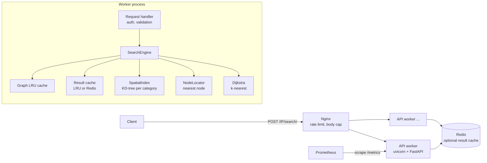

# Proximity Search

[](https://github.com/ashutosh229/proximity_search/actions/workflows/ci.yml)


A stateless, horizontally scalable HTTP service that answers one question:

> *Given a point, a category, and a radius, which K locations of that category are **closest by network distance** over a caller-supplied link graph?*

Candidates are pre-filtered spatially (per-category KD-tree), then ranked by an early-terminating Dijkstra over the uploaded linkage graph. Results are cached (in-process LRU or shared Redis), instrumented with Prometheus, and shipped as a hardened container with Docker Compose and Kubernetes manifests.

---

## Table of Contents

1. [Features](#features)
2. [Architecture](#architecture)
3. [Query Semantics](#query-semantics)
4. [Quick Start](#quick-start)
5. [API Reference](#api-reference)
6. [Data Formats](#data-formats)
7. [Configuration](#configuration)
8. [Deployment](#deployment)
9. [Observability](#observability)
10. [Performance and Capacity Planning](#performance-and-capacity-planning)
11. [Security](#security)
12. [Operations Runbook](#operations-runbook)
13. [Known Limitations](#known-limitations)
14. [Development](#development)
15. [CI/CD](#cicd)
16. [Project Layout](#project-layout)
17. [License](#license)

---

## Features

- **Network-distance ranking**: Dijkstra over the caller's linkage graph with early exit after K targets are finalized.
- **Fast spatial prefilter**: one `scipy.spatial.cKDTree` per category, with a brute-force path kept for verification and benchmarking.
- **Two linkage formats**: node-ID pairs (`id id`) or coordinate pairs (`lon lat lon lat`) with tolerance-based snapping.
- **Two edge-weight modes**: unit-weight `grid` (default) or Euclidean `geographic`; directed or undirected graphs.
- **Two-level caching**: parsed-graph LRU plus query-result cache (in-process LRU, or Redis shared across replicas; Redis fails open).
- **Prometheus metrics** with multiprocess support, JSON structured access logs, and `x-request-id` propagation.
- **Liveness/readiness endpoints**, graceful shutdown, non-root container, multi-stage image, Trivy and `pip-audit` gates in CI.
- **Nginx edge** with per-IP rate limiting, keep-alive upstream, and `/metrics` ACL.
- **Kubernetes manifests** with startup/readiness/liveness probes and a CPU-based HPA.

---

## Architecture



### Request lifecycle

1. Nginx rate-limits and forwards `POST /IP/search/`.
2. The handler checks the API key (constant-time compare), readiness, and input validity.
3. The uploaded linkage file is decoded and hashed (SHA-1) to form a graph identity. A cache hit skips parsing; a miss builds the adjacency map under a lock (double-checked) and stores it.
4. A result-cache key is derived from `(lat, lon, category, radius, graph identity, algorithm version, K)`. A hit returns immediately.
5. On a miss: KD-tree radius filter, then nearest-node snap of the query point as the Dijkstra source, then K-nearest by graph distance.
6. CPU-bound work runs in Starlette's threadpool so the event loop stays responsive.

### Process model

Each uvicorn worker is an independent process holding its **own** copy of the location dataset, spatial indexes, and in-process caches. Workers share nothing except Redis (if configured) and the Prometheus multiprocess directory. Scale by adding workers or replicas; memory cost scales linearly with both.

---

## Query Semantics

Be precise about what the service computes. Several behaviors are deliberate and affect correctness of downstream use.

| Aspect | Behavior |
|---|---|
| **Radius filter** | Euclidean distance in raw coordinate space, `hypot(Δlat, Δlon)`, **inclusive** (`<= rad`, with a `1e-9` epsilon). Units are whatever your coordinates are in (degrees for lat/lon). It is **not** haversine or meters. |
| **Category match** | Case-insensitive, whitespace-trimmed (`casefold`). `" Bank "` matches `bank`. |
| **Source node** | The location nearest (Euclidean) to the query point, regardless of its category. Ties resolve to the lowest ID. |
| **Ranking** | Ascending shortest-path distance over the uploaded graph. Ties resolve by lowest ID. |
| **Reachability** | Candidates unreachable from the source are omitted, so fewer than K results (or none) is normal. |
| **Path scope** | The radius constrains *candidates*, not the *path*. Shortest paths may traverse nodes outside the radius. |
| **Result size** | At most `TOP_K` (default 10). |
| **Edge weights** | `grid`: every edge costs `1.0` (hop count). `geographic`: Euclidean length of the edge. |
| **Duplicate edges** | Minimum weight wins. Self-loops and unknown nodes are dropped and counted in graph stats. |

---

## Quick Start

### Prerequisites

- Python 3.12 (local) or Docker 24+ with Compose v2
- A locations dataset (`data/locations.csv`). A synthetic generator is included.

### Run with Docker Compose

```bash
make data        # generate sample data: data/locations.csv + data/link.txt
make docker      # docker compose up --build  (Nginx on :80)
```

```bash
curl -s -X POST http://localhost/IP/search/ \
  -F lat=0.5 -F long=0.5 -F cat=bank -F rad=0.3 \
  -F "link=@data/link.txt;type=text/plain"
# {"locations":[4951,4850, ...]}
```

> The image **bakes in** `./data` at build time (`COPY data ./data`) and Compose additionally bind-mounts `./data` read-only. Generate or provide data **before** `docker build`.

### Run locally

```bash
python -m venv .venv && source .venv/bin/activate
make install
make data
make run         # uvicorn on :8080 with --reload
curl -s localhost:8080/ready
```

Interactive OpenAPI docs are served by FastAPI at `/docs` (see [Security](#security) before exposing publicly).

---

## API Reference

### `POST /IP/search/`

Content type: `multipart/form-data`.

| Field | Type | Required | Constraints |
|---|---|---|---|
| `lat` | float | yes | finite |
| `long` | float | yes | finite |
| `cat` | string | yes | 1-64 chars after trimming |
| `rad` | float | yes | finite, `>= 0` |
| `link` | file | yes | non-empty; UTF-8 text (BOM tolerated); see [Data Formats](#data-formats) |

Header: `X-API-Key: <key>` (required only when `API_KEY` is set).

**200 OK**

```json
{ "locations": [4951, 4850, 5052] }
```

An empty list is a valid result (no candidates in range, or none reachable).

| Status | Cause |
|---|---|
| `401` | `API_KEY` configured and header missing/incorrect |
| `422` | Missing field, non-numeric or non-finite `lat`/`long`/`rad`, negative `rad`, `cat` outside 1-64 chars, empty `link` file |
| `503` | Engine not ready (startup incomplete) |
| `404` | Linkage file not found (server-side path resolution; not reachable via the multipart upload path) |

### Operational endpoints

| Endpoint | Purpose | Notes |
|---|---|---|
| `GET /health` | Liveness | Always `{"status":"ok"}` while the process is up |
| `GET /ready` | Readiness | `503` until the dataset is loaded |
| `GET /metrics` | Prometheus exposition | Restricted by Nginx ACL; see [Security](#security) |

Every response carries an `x-request-id` header (echoed from the request or generated).

---

## Data Formats

### Locations: `locations.csv`

Loaded once at startup. A malformed file **aborts startup** (fail fast).

```csv
ID,Latitude,Longitude,Category
1,0.000000,0.000000,bank
2,0.000000,0.010101,hospital
```

- Header is required, case-insensitive; columns may appear in any order.
- `ID` is an integer and must be unique; `Latitude`/`Longitude` must be finite.
- Categories are normalized with `casefold`.
- Blank rows are skipped. UTF-8 BOM is accepted.

### Linkage: uploaded `link` file

One edge per line. Blank lines and lines beginning with `#` are ignored. Separators may be spaces or commas.

**ID format** (2 fields):

```
1 2
2 3
```

**Coordinate format** (4 fields, **longitude first**):

```
lon_a lat_a lon_b lat_b
0.000000 0.000000 0.010101 0.000000
```

Coordinate endpoints are resolved to location IDs by exact match at 1e-6 precision, falling back to nearest-neighbour snapping within a tolerance of `1e-4`. Endpoints that cannot be resolved are counted as `unknown_node` and skipped.

Graphs are **undirected** by default (each line produces both directions) unless `DIRECTED_LINKS=true`. Malformed lines, unknown nodes, self-loops, and duplicate edges are tallied; a warning with these stats is logged whenever malformed or unknown-node lines are present.

---

## Configuration

All configuration is via environment variables (12-factor). Invalid `EDGE_WEIGHT_MODE` fails startup.

| Variable | Default | Description |
|---|---|---|
| `DATA_DIR` | `data` (`/srv/data` in image) | Directory containing the locations file and server-side linkage files |
| `LOCATIONS_FILE` | `locations.csv` | Locations CSV filename inside `DATA_DIR` |
| `EDGE_WEIGHT_MODE` | `grid` | `grid` (unit weights) or `geographic` (Euclidean) |
| `DIRECTED_LINKS` | `false` | Treat each linkage line as one directed edge |
| `TOP_K` | `10` | Max results per query |
| `USE_KDTREE` | `true` | Use per-category KD-trees; `false` forces brute-force filtering |
| `CACHE_SIZE` | `1024` | In-process result-cache capacity (entries, per worker). `0` disables |
| `GRAPH_CACHE_SIZE` | `4` | Parsed graphs retained per worker (LRU) |
| `REDIS_URL` | *(unset)* | Enables shared Redis result cache, e.g. `redis://redis:6379/0` |
| `REDIS_TTL` | `3600` | Redis entry TTL in seconds |
| `API_KEY` | *(unset)* | When set, requires matching `X-API-Key`. Unset disables auth |
| `PRELOAD_LINKS` | `link.txt` in Compose/K8s | Comma-separated linkage files in `DATA_DIR` parsed at startup (see [limitations](#known-limitations)) |
| `DEFAULT_LINK` | *(unset)* | Additional linkage file parsed at startup |
| `WEB_CONCURRENCY` | `4` (Compose), `2` (K8s) | Uvicorn worker processes |
| `LOG_LEVEL` | `INFO` | Python log level |
| `PROMETHEUS_MULTIPROC_DIR` | `/tmp/prom` (image) | Metrics aggregation directory across workers; cleared on container start |

> **Changing `EDGE_WEIGHT_MODE` or `DIRECTED_LINKS` changes results.** Both are part of the graph identity, so cached graphs are not mixed, but they alter ranking semantics for every client. Treat them as deploy-time contract settings.

---

## Deployment

### Docker image

- Multi-stage build on `python:3.12-slim`; dependencies installed to an isolated prefix and copied into the runtime stage.
- Runs as non-root user `app` (UID `10001`).
- `HEALTHCHECK` polls `/ready` every 15s (20s start period).
- Entrypoint: `uvicorn app.main:app --proxy-headers --timeout-graceful-shutdown 20`. Worker count comes from `WEB_CONCURRENCY`.

### Docker Compose (single host)

```bash
export API_KEY="$(openssl rand -hex 32)"
export WEB_CONCURRENCY=4
make data && docker compose up --build -d
```

- Nginx is the only published port (`80`); the API is `expose`d on the internal network only.
- The API is capped at 4 CPUs / 2 GiB. Nginx waits for the API healthcheck (`service_healthy`).
- Terminate TLS in front of Nginx (cloud LB, Caddy, Traefik) or extend `nginx.conf` with a `443` server block.

### Kubernetes

`k8s.yaml` provides a `Deployment`, `Service`, and `HorizontalPodAutoscaler`.

```bash
sed -e 's#REGISTRY/proximity-search:TAG#ghcr.io/<owner>/proximity_search:<sha>#' k8s.yaml | kubectl apply -f -
```

| Setting | Value |
|---|---|
| Replicas / HPA | 2 min, 10 max, target 65% CPU |
| Requests / limits | 1 CPU, 512 Mi / 2 CPU, 1 Gi |
| `WEB_CONCURRENCY` | 2 |
| Startup probe | `/ready`, up to 30 failures at 2s (about 60s to load) |
| Readiness probe | `/ready` every 5s |
| Liveness probe | `/health` every 10s, 3 failures |
| Scrape annotations | `prometheus.io/scrape: "true"`, port `8000` |

Before production, add or verify:

- **Secrets**: uncomment the `API_KEY` `secretKeyRef` and create `ps-secret`.
- **Redis**: uncomment `REDIS_URL`. Without it, each pod and each worker holds a separate cache, so hit rates fall as you scale out.
- **Ingress/Gateway**, TLS, and a `NetworkPolicy` (not included).
- **PodDisruptionBudget** and topology spread constraints (not included).
- **Memory sizing**: every worker loads the full dataset. Set `limits.memory` from measured RSS (see below), not guesses.
- Confirm `terminationGracePeriodSeconds` (default 30s) exceeds the 20s graceful-shutdown timeout.

### Rollout and data updates

The locations dataset is read **only at startup** and is baked into the image. To change it: rebuild or remount, then perform a rolling restart. Server-side linkage files are fingerprinted by `(path, mtime, size)`, but the HTTP API consumes uploaded linkage text, which is fingerprinted by content hash.

---

## Observability

### Metrics (`GET /metrics`)

| Metric | Type | Meaning |
|---|---|---|
| `ip_requests_total` | counter | Requests received (counted before auth) |
| `ip_request_errors_total` | counter | Requests that raised an `HTTPException` (401/422/503/404). Unhandled 5xx are not counted here |
| `ip_request_latency_seconds` | histogram | Handler latency; buckets 1ms-1s |
| `ip_cache_hits_total` / `ip_cache_misses_total` | counter | Result-cache outcome |
| `ip_graph_cache_hits_total` | counter | Parsed-graph cache hits |
| `ip_graph_builds_total` | counter | Graph parses (cache misses) |
| `ip_last_graph_build_seconds` | gauge | Duration of the most recent graph build |
| `ip_candidates_total` | counter | Candidates produced by the radius filter |
| `ip_nodes_finalized_total` | counter | Dijkstra nodes settled |
| `ip_edge_relaxations_total` | counter | Dijkstra edge relaxations |
| `ip_startup_seconds` / `ip_locations_loaded` | gauge | Startup duration / dataset size |
| `ip_cache_entries` | gauge | In-process result-cache size (always `0` with Redis) |

Metrics are aggregated across workers via `PROMETHEUS_MULTIPROC_DIR`.

### Suggested alerts

```yaml
# Error ratio
- alert: ProximitySearchHighErrorRate
  expr: rate(ip_request_errors_total[5m]) / rate(ip_requests_total[5m]) > 0.05
  for: 10m

# p95 latency
- alert: ProximitySearchSlowP95
  expr: histogram_quantile(0.95, sum by (le) (rate(ip_request_latency_seconds_bucket[5m]))) > 0.25
  for: 10m

# Graph thrash: parsing uploads constantly means clients send many distinct linkage files
- alert: ProximitySearchGraphChurn
  expr: rate(ip_graph_builds_total[10m]) > 0.5
  for: 15m

# Search work per candidate rising: topology or radius shifts
- alert: ProximitySearchDijkstraCostHigh
  expr: rate(ip_nodes_finalized_total[10m]) / rate(ip_cache_misses_total[10m]) > 20000
  for: 15m
```

Tune thresholds to your baseline from load tests.

### Logs

Access logs are one JSON object per request on the `access` logger:

```json
{"rid": "9f2c...", "method": "POST", "path": "/IP/search/", "status": 200, "ms": 12.41}
```

Application logs use `%(asctime)s %(levelname)s %(name)s %(message)s`. Ship stdout to your log pipeline and index on `rid` for tracing; Nginx forwards client-supplied `x-request-id` to the API.

---

## Performance and Capacity Planning

**Algorithmic profile**

- Radius filter: KD-tree range query plus an exact distance check on the candidate subset.
- Ranking: Dijkstra with early termination once K targets are settled. Cost is driven by how far from the source the K-th reachable candidate lies, not by total graph size. Worst case (sparse or unreachable targets) explores the whole connected component.
- Cache hit: a dictionary or Redis lookup.

**Measure, do not assume.** The repo ships the tools:

```bash
make bench                                   # brute-force vs KD-tree filter, end-to-end p50/p90/p95/p99 and single-thread QPS
python scripts/build_index.py link.txt       # startup index build, graph build, edge count, peak RSS
make load                                    # Locust: 100 users, 20/s spawn, 60s against http://localhost
python scripts/validate_dataset.py data/locations.csv data/link.txt   # dataset and linkage sanity stats
```

**Sizing guidance**

1. Run `build_index.py` against production-scale data to get **peak RSS per worker**.
2. Memory per pod is approximately `WEB_CONCURRENCY x per-worker RSS` plus headroom for `GRAPH_CACHE_SIZE` parsed graphs and result caches.
3. CPU is the primary scaling axis (pure-Python Dijkstra). Prefer more replicas with `WEB_CONCURRENCY` close to the CPU limit.
4. Upload size is bounded by Nginx `client_max_body_size 64m`. Graph parse time grows linearly with linkage lines; `ip_last_graph_build_seconds` shows the cost.
5. Use Redis when running more than one replica **and** clients repeat queries. In-process caches are per worker.

**Redis behavior**: socket and connect timeouts are 50 ms and all errors are swallowed (logged at WARNING), so the service degrades to computing every query instead of failing. During a Redis outage this adds up to roughly 100 ms of timeout latency per request (get plus put) until the dependency recovers or is removed.

---

## Security

| Control | Status |
|---|---|
| Authentication | Optional shared secret via `X-API-Key`, compared with `hmac.compare_digest`. **Disabled when `API_KEY` is unset.** Always set it outside local development |
| Input validation | Finite-number checks, `rad >= 0`, category length, non-empty upload |
| Rate limiting | Nginx `limit_req` on `/IP/`: 50 r/s per client IP, burst 100 |
| Body limit | 64 MB at Nginx |
| Container | Non-root (UID 10001), slim base image, no build tooling in runtime stage |
| Supply chain | `pip-audit` on requirements and Trivy (CRITICAL/HIGH, unfixed ignored) in CI |
| Transport | **No TLS in this repo.** Terminate at your ingress or load balancer |

Hardening notes before exposing to the internet:

- **Metrics ACL**: Nginx allows `127.0.0.1`, `10.0.0.0/8`, `172.16.0.0/12`. On Docker bridge networks, published-port traffic can appear to come from the bridge gateway (`172.x`), which would match the allow list. Do not rely on it as the only control; scrape over the internal network and block `/metrics` at the edge.
- **Client IP for rate limiting**: `limit_req` keys on `$binary_remote_addr`. Behind a load balancer every client shares its address; configure `real_ip_header` / `set_real_ip_from` in Nginx.
- **API docs**: FastAPI's `/docs` and `/openapi.json` are enabled by default. Block them at the edge or disable them in production.
- **Authentication ordering**: multipart bodies are parsed by the framework before the handler's key check runs, so unauthenticated large uploads still consume bandwidth and memory up to the body limit. Enforce auth or WAF rules at the edge for hostile environments, and lower `client_max_body_size` to your real maximum linkage size.
- **Key rotation**: `API_KEY` is read at process start; rotate via a rolling restart.

---

## Operations Runbook

| Symptom | Likely cause | Action |
|---|---|---|
| Container exits at start with `DatasetError` | Missing or malformed `locations.csv` (bad header, duplicate ID, non-finite coordinate) | Run `python scripts/validate_dataset.py <csv>`; fix the data |
| Startup fails with `LinkageNotFound` | A `PRELOAD_LINKS` / `DEFAULT_LINK` file is missing from `DATA_DIR` | Fix the filename or clear the variable |
| Pod never becomes Ready | Dataset load slower than startup probe window (60s) | Raise `failureThreshold` or check `ip_startup_seconds` |
| `401` for valid clients | Header name or value mismatch, or secret rotated | Send `X-API-Key`; verify `API_KEY` in the pod |
| `422` on every request | Client sending `long_` instead of `long`, or not multipart | Use form fields exactly as documented |
| Empty results unexpectedly | Radius too small (units are coordinate units, not km); category typo; source node isolated or disconnected from candidates | Test with a larger `rad`; check linkage stats in the warning log; confirm the category exists |
| Results differ between environments | Different `EDGE_WEIGHT_MODE` or `DIRECTED_LINKS` | Align env vars; they alter ranking |
| Latency spike after deploy | Cold caches and graph rebuilds | Watch `ip_graph_builds_total` and cache hit ratio; consider Redis |
| `ip_graph_builds_total` climbing steadily | Clients upload many distinct linkage files; `GRAPH_CACHE_SIZE=4` too small | Raise `GRAPH_CACHE_SIZE` (watch memory) or have clients reuse files |
| WARNING `redis get failed` | Redis down or exceeding the 50 ms timeout | Restore Redis; service continues uncached |
| OOMKilled | Workers x per-worker RSS exceeds limit | Reduce `WEB_CONCURRENCY` or raise memory limit |
| Rate-limited (`503` from Nginx) | Burst above 50 r/s per IP plus 100 burst | Adjust `limit_req_zone` or fix client retry storms |

Graceful shutdown: on `SIGTERM` uvicorn stops accepting connections and drains in-flight requests for up to 20 seconds.

---

## Known Limitations

Documented here so operators are not surprised.

- **Preloading does not warm the HTTP path.** `PRELOAD_LINKS` / `DEFAULT_LINK` parse server-side files under a *file-based* cache identity, but the API always receives linkage as an upload keyed by a *content-hash* identity. Preloaded graphs therefore validate the files and occupy `GRAPH_CACHE_SIZE` slots without being hit by API traffic. For an upload-only deployment, set `PRELOAD_LINKS=` (empty) to reclaim the slots and skip the startup parse.
- **Planar Euclidean model.** Radius and nearest-node logic use raw coordinate distance, not great-circle distance. Appropriate for normalized or projected grids, approximate for real lat/lon at scale.
- **In-memory dataset.** All locations and indexes are loaded per worker; there is no hot reload of `locations.csv`.
- **Per-worker in-process caches.** Without Redis, hit rates fall as workers and replicas increase.
- **Redis key hygiene.** Keys are `ip:` plus the `repr` of the query tuple (including the graph identity); there is no namespace versioning other than `algorithm_version`. Use a dedicated Redis DB and flush on algorithm or semantic changes.
- **Pure-Python Dijkstra.** Adequate for the tested 100x100 grid profile (see `tests/benchmark`); very large or dense graphs will need profiling, a compiled shortest-path implementation, or precomputation.

---

## Development

```bash
make install     # pip install -r requirements-dev.txt
make data        # generate synthetic dataset (100x100 grid, 8 categories)
make lint        # ruff check app tests scripts
make test        # pytest -q (unit, integration, benchmark smoke)
make run         # dev server with reload on :8080
```

Generate a different dataset:

```bash
python scripts/generate_sample_data.py --out data --n 200 --keep 0.85 --seed 11
```

| Make target | Description |
|---|---|
| `install` | Install runtime and dev dependencies |
| `data` | Generate `data/locations.csv` and `data/link.txt` |
| `test` | Run the full pytest suite |
| `lint` | Ruff lint (`line-length = 120`) |
| `run` | Hot-reload dev server |
| `bench` | Radius-filter and end-to-end benchmark |
| `docker` | Build and start the Compose stack |
| `load` | Headless Locust load test |

### Testing strategy

- **Unit** (`tests/unit`): shortest-path correctness vs. oracle, tie-breaking, early termination, KD-tree vs. brute-force equivalence (including inclusive boundaries), linkage parsing policies, snapping tolerance, loader errors.
- **Integration** (`tests/integration`): full HTTP flow, both linkage formats, upload isolation (different graphs never confused), auth, validation, edge-weight modes, cache and metrics endpoints.
- **Benchmark smoke** (`tests/benchmark`): Dijkstra on a 100x100 grid must complete under 0.5s.

---

## CI/CD

GitHub Actions (`.github/workflows/ci.yml`) on every push and PR:

1. **test**: `ruff`, `pip-audit`, unit tests, then integration and benchmark tests.
2. **docker** (after `test`): generate data, build the image tagged `ghcr.io/<repo>:<sha>`, run it, wait for `/ready`, send a real multipart search, check `/metrics`, then run a **Trivy** scan (fails on CRITICAL/HIGH with available fixes).
3. On `main` only: log in to GHCR and push the SHA-tagged image.

Images are tagged by commit SHA. Deploy by SHA and promote the same artifact across environments.

---

## Project Layout

```
.
├── app/
│   ├── main.py                 # app factory, lifespan, access logging, ops endpoints
│   ├── config.py               # env-driven immutable Settings
│   ├── api/search.py           # POST /IP/search/
│   ├── core/
│   │   ├── search_engine.py    # orchestration, graph + result caches
│   │   ├── spatial_index.py    # KD-tree per category, nearest-node locator
│   │   ├── shortest_path.py    # early-exit Dijkstra
│   │   ├── graph.py            # adjacency-list graph
│   │   └── cache.py            # LRUCache, RedisCache (fail-open)
│   ├── loaders/                # locations CSV + linkage parsing/snapping
│   ├── models/                 # Location, response schema
│   └── utils/                  # distance/weights, Prometheus metrics
├── scripts/                    # benchmark, build_index, generate_sample_data, validate_dataset, locustfile
├── tests/                      # unit / integration / benchmark
├── Dockerfile
├── docker-compose.yml
├── nginx.conf
├── k8s.yaml
├── Makefile
└── .github/workflows/ci.yml
```

---

## License

Released under the [MIT License](LICENSE). Copyright (c) 2026 Ashutosh Kumar Jha.

Source: <https://github.com/ashutosh229/proximity_search>
